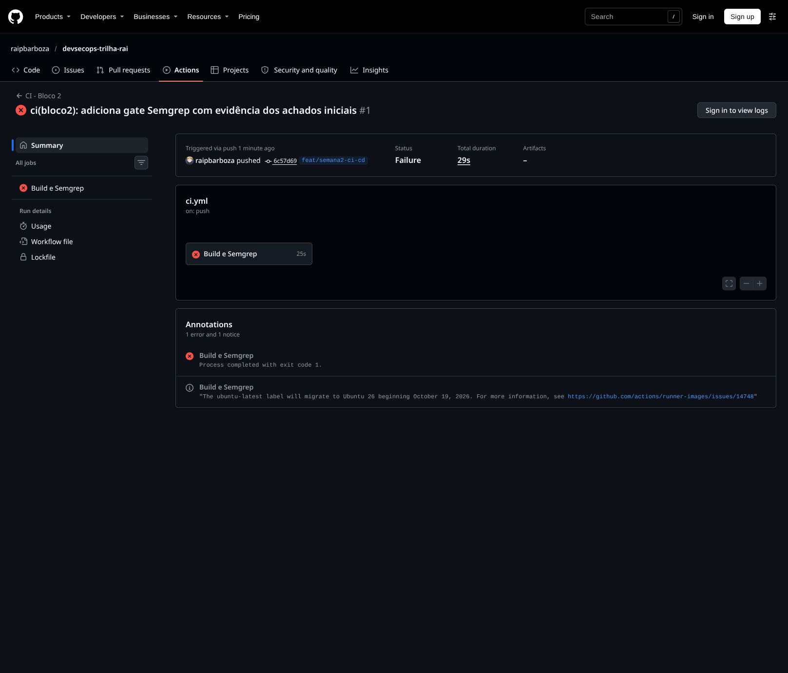
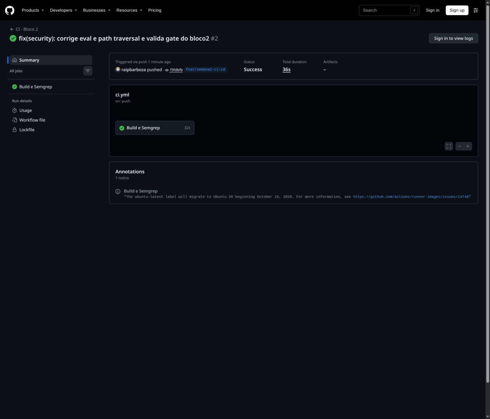

# Bloco 2 — CI e gate de segurança

## Workflow

O arquivo executável é `.github/workflows/ci.yml`. A cópia `bloco2/ci.yml` atende à entrega da mentoria e deve permanecer idêntica ao original.

Cada push (em qualquer branch), pull request ou execução manual instala as dependências com `npm ci`, verifica a sintaxe JavaScript, executa os testes e roda Semgrep CE 1.183.0 com o conjunto oficial `p/javascript` sobre `app/src`.

O gate usa `--severity ERROR --severity WARNING --error --strict`: achados dessas severidades retornam código 1, e erros de configuração/execução também não são ignorados. Não há `continue-on-error`, `nosemgrep` nem exclusão dos arquivos vulneráveis. O conjunto do Registry pode mudar; a versão da ferramenta está fixada, mas as regras são obtidas do serviço a cada execução.

## Achados e correções

| Achado | Severidade | Correção |
| --- | --- | --- |
| `code-string-concat` em `routes/tasks.js` | ERROR | Remoção de `eval(expr)` e substituição por filtros `done` e `owner` validados. |
| `express-path-join-resolve-traversal` em `routes/files.js` | WARNING | Validação do nome do arquivo antes de construir o caminho, rejeitando separadores, arquivos ocultos e nomes inválidos. |

O contrato de `/api/tasks/filter` mudou: `expr` deixa de ser aceito. Exemplos válidos: `/api/tasks/filter?done=false`, `/api/tasks/filter?owner=mentoria` ou a combinação dos dois. Expressões antigas retornam HTTP 400.

## Evidências locais reais

- `evidencias/semgrep-antes.txt` e `.json`: dois achados, processo retornando **1**, antes das correções.
- `evidencias/semgrep-depois.txt` e `.json`: nenhum achado nas mesmas severidades, processo retornando **0**, após as correções.
- `evidencias/testes.txt`: seis testes de integração, incluindo tentativas de execução de código e de saída da pasta de arquivos.

Esses arquivos são saídas locais da ferramenta, não prints de execuções no GitHub Actions.

## Execuções reais no GitHub Actions

A branch `feat/semana2-ci-cd` foi publicada em duas etapas, preservando o histórico:

| Cenário | Commit | Resultado | Execução |
| --- | --- | --- | --- |
| Antes das correções | `6c57d69` | Failure — saída 1 no gate | [Execução 1](https://github.com/raipbarboza/devsecops-trilha-rai/actions/runs/41105932477) |
| Após as correções | `f3fdbfb` | Success | [Execução 2](https://github.com/raipbarboza/devsecops-trilha-rai/actions/runs/41106176078) |

Prints reais das páginas de resultado:

Os prints mostram os resumos das execuções. O print adicional dos logs com os achados ainda está pendente: o GitHub exige login para visualizar esses logs e o navegador disponível está sem sessão autenticada. Os dois alertas estão registrados nas evidências locais acima; elas não substituem o print dos logs exigido pela mentoria.

## Pendências para fechar a entrega

1. Entrar no GitHub, abrir a execução 1, expandir a etapa SAST e salvar o print com os achados em `bloco2/evidencias/semgrep-actions-achados.jpg`.
2. Em **Settings → Rules → Rulesets** (ou proteção de branches), proteger `main`, exigir pull request e o status check **Build e Semgrep**. Evitar permissões de bypass se a intenção for bloquear todos os merges que falhem. A pipeline vermelha, sozinha, não impede o merge sem essa configuração.
3. Abrir o pull request da branch para `main` e conferir o check obrigatório antes do merge.
4. Registrar as evidências adicionais em commit dentro de `bloco2/` antes do prazo da Semana 4 informado pela mentoria. A data exata desse prazo não consta no enunciado recebido.

Não foi realizada implantação pública nem merge na branch `main`.

## Origem e limites

Código-base: https://github.com/SACI-UFLA/onboarding-2026-2/tree/main/Trilhas/DevSecOps/app-student, commit `a0fb4a39c8e656de707f7acaf03ee01d57168cee`.

Na importação, os valores fixos de configuração didática foram substituídos por variáveis de ambiente; esse módulo não é consumido pela API atual. As outras correções estão em commit separado para preservar o cenário inicial do SAST.

O verde significa ausência de achados nas regras e severidades configuradas, não ausência de vulnerabilidades. A base continua contendo problemas didáticos, incluindo uso de shell em `/api/ping`, atualização indiscriminada de propriedades e dependências antigas. Esta entrega não inclui SCA, DAST ou autorização de usuários; não deve ser tratada como aplicação pronta para produção. O Dockerfile original foi preservado e não é executado por este workflow.

## Referências

- Semgrep CLI e códigos de saída: https://docs.semgrep.dev/cli-reference
- Proteção de branches: https://docs.github.com/en/repositories/configuring-branches-and-merges-in-your-repository/managing-protected-branches/about-protected-branches
- OWASP CI/CD Security: https://cheatsheetseries.owasp.org/cheatsheets/CI_CD_Security_Cheat_Sheet.html
